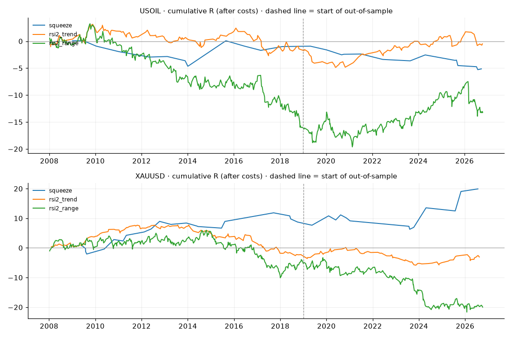

# วิจัยกติกาน้ำมัน (Backtest รอบ 3 · แท่งวัน ตั้งแต่ 2008)

squeeze = breakout หลังความผันผวนหด · rsi2_trend = สวนระยะสั้นตาม MA200 · rsi2_range = สวนระยะสั้นไม่กรองเทรนด์ (ดูคำอธิบายใน backtest_oil.py)

พารามิเตอร์คงที่ ไม่ปรับจูน · หักค่า spread/slippage แล้ว · นับแบบระมัดระวัง · R = กำไรเทียบความเสี่ยงต่อไม้

## สรุปผ่าน/ไม่ผ่าน (ต้องได้ profit factor ≥ 1.2 ทั้งช่วง 2008–2018 และ 2019–ปัจจุบัน)

| ตัว | squeeze | rsi2_trend | rsi2_range |
|---|---|---|---|
| USOIL | ไม้น้อยเกินตัดสิน | ❌ ไม่ผ่าน | ❌ ไม่ผ่าน |
| XAUUSD | ไม้น้อยเกินตัดสิน | ❌ ไม่ผ่าน | ❌ ไม่ผ่าน |

ดูแยกฝั่ง Buy / Sell ใน `output/backtest_oil_summary.csv`

## USOIL (ค่าใช้จ่ายต่อไม้ 0.05)

| strategy | period | trades | trades_per_year | win_rate_% | avg_R | R_per_year | profit_factor | max_drawdown_R | worst_losing_streak | avg_days_held |
|---|---|---|---|---|---|---|---|---|---|---|
| squeeze | ทั้งหมด | 27 | 1.5 | 44.4 | -0.19 | -0.3 | 0.58 | 5.4 | 3 | 12.0 |
| squeeze | 2008–2018 | 13 | 1.4 | 46.2 | -0.077 | -0.1 | 0.85 | 4.7 | 3 | 11.7 |
| squeeze | 2019–ปัจจุบัน (OOS) | 14 | 1.9 | 42.9 | -0.296 | -0.6 | 0.27 | 4.4 | 3 | 12.4 |
| rsi2_trend | ทั้งหมด | 213 | 11.4 | 60.1 | -0.002 | -0.0 | 0.99 | 8.0 | 6 | 3.0 |
| rsi2_trend | 2008–2018 | 125 | 11.6 | 58.4 | -0.011 | -0.1 | 0.95 | 5.8 | 5 | 3.0 |
| rsi2_trend | 2019–ปัจจุบัน (OOS) | 88 | 11.3 | 62.5 | 0.011 | 0.1 | 1.07 | 3.4 | 6 | 2.9 |
| rsi2_range | ทั้งหมด | 546 | 29.1 | 58.6 | -0.024 | -0.7 | 0.89 | 22.9 | 9 | 3.0 |
| rsi2_range | 2008–2018 | 311 | 28.3 | 56.9 | -0.051 | -1.5 | 0.78 | 19.3 | 9 | 3.2 |
| rsi2_range | 2019–ปัจจุบัน (OOS) | 235 | 30.3 | 60.9 | 0.012 | 0.4 | 1.06 | 6.5 | 5 | 2.8 |

## XAUUSD (ค่าใช้จ่ายต่อไม้ 0.5)

| strategy | period | trades | trades_per_year | win_rate_% | avg_R | R_per_year | profit_factor | max_drawdown_R | worst_losing_streak | avg_days_held |
|---|---|---|---|---|---|---|---|---|---|---|
| squeeze | ทั้งหมด | 35 | 2.0 | 45.7 | 0.569 | 1.2 | 2.14 | 5.6 | 5 | 14.9 |
| squeeze | 2008–2018 | 21 | 2.2 | 47.6 | 0.416 | 0.9 | 1.97 | 3.1 | 3 | 15.1 |
| squeeze | 2019–ปัจจุบัน (OOS) | 14 | 1.9 | 42.9 | 0.799 | 1.6 | 2.34 | 4.9 | 5 | 14.4 |
| rsi2_trend | ทั้งหมด | 198 | 10.7 | 60.6 | -0.015 | -0.2 | 0.93 | 13.5 | 8 | 3.0 |
| rsi2_trend | 2008–2018 | 125 | 11.5 | 57.6 | -0.02 | -0.2 | 0.91 | 10.3 | 8 | 3.2 |
| rsi2_trend | 2019–ปัจจุบัน (OOS) | 73 | 9.8 | 65.8 | -0.008 | -0.1 | 0.96 | 6.0 | 3 | 2.7 |
| rsi2_range | ทั้งหมด | 577 | 30.8 | 59.6 | -0.035 | -1.1 | 0.87 | 27.6 | 5 | 2.9 |
| rsi2_range | 2008–2018 | 345 | 31.4 | 59.7 | -0.015 | -0.5 | 0.94 | 16.0 | 5 | 3.0 |
| rsi2_range | 2019–ปัจจุบัน (OOS) | 232 | 29.9 | 59.5 | -0.063 | -1.9 | 0.76 | 18.4 | 5 | 2.8 |

- profit factor ต่ำกว่า 1 = ขาดทุน · 1.2 ขึ้นไป = เริ่มน่าสนใจ
- max_drawdown_R ใช้ตั้งความเสี่ยงต่อไม้: DD 20R กับเสี่ยง 0.5% ต่อไม้ = พอร์ตติดลบ ~10%
- ฟิวเจอร์สต่อเนื่องของ Yahoo มีราคากระโดดตอนเปลี่ยนสัญญา ผลน้ำมันจึงคลาดเคลื่อนได้มากกว่าทอง
- ผลในอดีตไม่รับประกันอนาคต ไม่ใช่คำแนะนำการลงทุน
