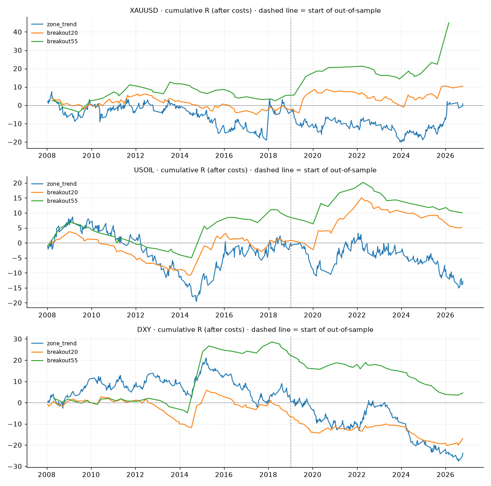

# ค้นหากติกาบอทเทรด (Backtest รอบ 2 · แท่งวัน ตั้งแต่ 2008)

แผนโซนเดิมในการ์ด LINE ดูผลแท่ง 1 ชม. ที่ `backtest_zones.md` (แท่งวันหยาบเกินสำหรับ SL แคบ)

พารามิเตอร์คงที่ ไม่ปรับจูน · หักค่า spread/slippage แล้ว · นับแบบระมัดระวัง · R = กำไรเทียบความเสี่ยงต่อไม้

## สรุปผ่าน/ไม่ผ่าน (ต้องได้ profit factor ≥ 1.2 ทั้งช่วง 2008–2018 และ 2019–ปัจจุบัน)

| ตัว | zone_trend | breakout20 | breakout55 |
|---|---|---|---|
| XAUUSD | ❌ ไม่ผ่าน | ❌ ไม่ผ่าน | ไม้น้อยเกินตัดสิน |
| USOIL | ❌ ไม่ผ่าน | 🟡 กำไรน้อย ยังไม่คุ้ม | ไม้น้อยเกินตัดสิน |
| DXY | ❌ ไม่ผ่าน | ❌ ไม่ผ่าน | ❌ ไม่ผ่าน |

ดูแยกฝั่ง Buy / Sell ใน `output/backtest_v2_summary.csv`

## XAUUSD (ค่าใช้จ่ายต่อไม้ 0.5)

| strategy | period | trades | trades_per_year | win_rate_% | avg_R | R_per_year | profit_factor | max_drawdown_R | worst_losing_streak | avg_days_held |
|---|---|---|---|---|---|---|---|---|---|---|
| zone_trend | ทั้งหมด | 517 | 27.5 | 46.2 | 0.001 | 0.0 | 1.0 | 27.4 | 9 | 3.5 |
| zone_trend | 2008–2018 | 312 | 28.6 | 46.2 | -0.015 | -0.4 | 0.98 | 26.4 | 8 | 3.2 |
| zone_trend | 2019–ปัจจุบัน (OOS) | 205 | 26.6 | 46.3 | 0.026 | 0.7 | 1.05 | 17.5 | 9 | 4.0 |
| breakout20 | ทั้งหมด | 126 | 6.7 | 34.9 | 0.083 | 0.6 | 1.15 | 11.3 | 6 | 13.3 |
| breakout20 | 2008–2018 | 74 | 6.8 | 33.8 | -0.032 | -0.2 | 0.95 | 11.3 | 6 | 13.1 |
| breakout20 | 2019–ปัจจุบัน (OOS) | 52 | 6.7 | 36.5 | 0.245 | 1.7 | 1.49 | 9.7 | 6 | 13.5 |
| breakout55 | ทั้งหมด | 62 | 3.4 | 38.7 | 0.725 | 2.5 | 2.17 | 10.3 | 5 | 27.1 |
| breakout55 | 2008–2018 | 39 | 3.6 | 33.3 | 0.137 | 0.5 | 1.2 | 10.3 | 5 | 24.7 |
| breakout55 | 2019–ปัจจุบัน (OOS) | 23 | 3.2 | 47.8 | 1.722 | 5.6 | 4.51 | 7.0 | 5 | 31.2 |

## USOIL (ค่าใช้จ่ายต่อไม้ 0.05)

| strategy | period | trades | trades_per_year | win_rate_% | avg_R | R_per_year | profit_factor | max_drawdown_R | worst_losing_streak | avg_days_held |
|---|---|---|---|---|---|---|---|---|---|---|
| zone_trend | ทั้งหมด | 481 | 25.6 | 49.5 | -0.027 | -0.7 | 0.95 | 28.2 | 10 | 4.0 |
| zone_trend | 2008–2018 | 285 | 25.9 | 50.9 | -0.001 | -0.0 | 1.0 | 28.2 | 6 | 3.9 |
| zone_trend | 2019–ปัจจุบัน (OOS) | 196 | 25.2 | 47.4 | -0.065 | -1.6 | 0.88 | 18.3 | 10 | 4.1 |
| breakout20 | ทั้งหมด | 110 | 5.9 | 39.1 | 0.047 | 0.3 | 1.11 | 14.6 | 8 | 14.8 |
| breakout20 | 2008–2018 | 71 | 6.5 | 39.4 | 0.012 | 0.1 | 1.03 | 14.6 | 8 | 14.4 |
| breakout20 | 2019–ปัจจุบัน (OOS) | 39 | 5.5 | 38.5 | 0.11 | 0.6 | 1.25 | 10.0 | 6 | 15.7 |
| breakout55 | ทั้งหมด | 59 | 3.1 | 28.8 | 0.17 | 0.5 | 1.28 | 11.9 | 6 | 25.4 |
| breakout55 | 2008–2018 | 36 | 3.3 | 25.0 | 0.233 | 0.8 | 1.4 | 11.9 | 6 | 26.5 |
| breakout55 | 2019–ปัจจุบัน (OOS) | 23 | 3.2 | 34.8 | 0.07 | 0.2 | 1.11 | 10.2 | 6 | 23.6 |

## DXY (ค่าใช้จ่ายต่อไม้ 0.03)

| strategy | period | trades | trades_per_year | win_rate_% | avg_R | R_per_year | profit_factor | max_drawdown_R | worst_losing_streak | avg_days_held |
|---|---|---|---|---|---|---|---|---|---|---|
| zone_trend | ทั้งหมด | 488 | 26.0 | 50.8 | -0.049 | -1.3 | 0.91 | 48.6 | 9 | 4.1 |
| zone_trend | 2008–2018 | 278 | 25.3 | 54.3 | 0.005 | 0.1 | 1.01 | 23.3 | 9 | 4.4 |
| zone_trend | 2019–ปัจจุบัน (OOS) | 210 | 27.0 | 46.2 | -0.121 | -3.3 | 0.79 | 29.7 | 6 | 3.7 |
| breakout20 | ทั้งหมด | 129 | 6.9 | 26.4 | -0.131 | -0.9 | 0.76 | 26.0 | 19 | 13.7 |
| breakout20 | 2008–2018 | 78 | 7.1 | 23.1 | -0.083 | -0.6 | 0.86 | 14.6 | 18 | 14.1 |
| breakout20 | 2019–ปัจจุบัน (OOS) | 51 | 6.6 | 31.4 | -0.205 | -1.4 | 0.59 | 13.7 | 10 | 13.2 |
| breakout55 | ทั้งหมด | 76 | 4.1 | 23.7 | 0.06 | 0.2 | 1.09 | 25.1 | 17 | 20.3 |
| breakout55 | 2008–2018 | 39 | 3.6 | 30.8 | 0.575 | 2.1 | 1.88 | 6.9 | 7 | 25.0 |
| breakout55 | 2019–ปัจจุบัน (OOS) | 37 | 4.9 | 16.2 | -0.483 | -2.3 | 0.33 | 18.9 | 17 | 15.4 |

- profit factor ต่ำกว่า 1 = ขาดทุน · 1.2 ขึ้นไป = เริ่มน่าสนใจ
- max_drawdown_R ใช้ตั้งความเสี่ยงต่อไม้: DD 20R กับเสี่ยง 0.5% ต่อไม้ = พอร์ตติดลบ ~10%
- ฟิวเจอร์สต่อเนื่องของ Yahoo มีราคากระโดดตอนเปลี่ยนสัญญา ผลน้ำมันจึงคลาดเคลื่อนได้มากกว่าทอง
- ผลในอดีตไม่รับประกันอนาคต ไม่ใช่คำแนะนำการลงทุน
