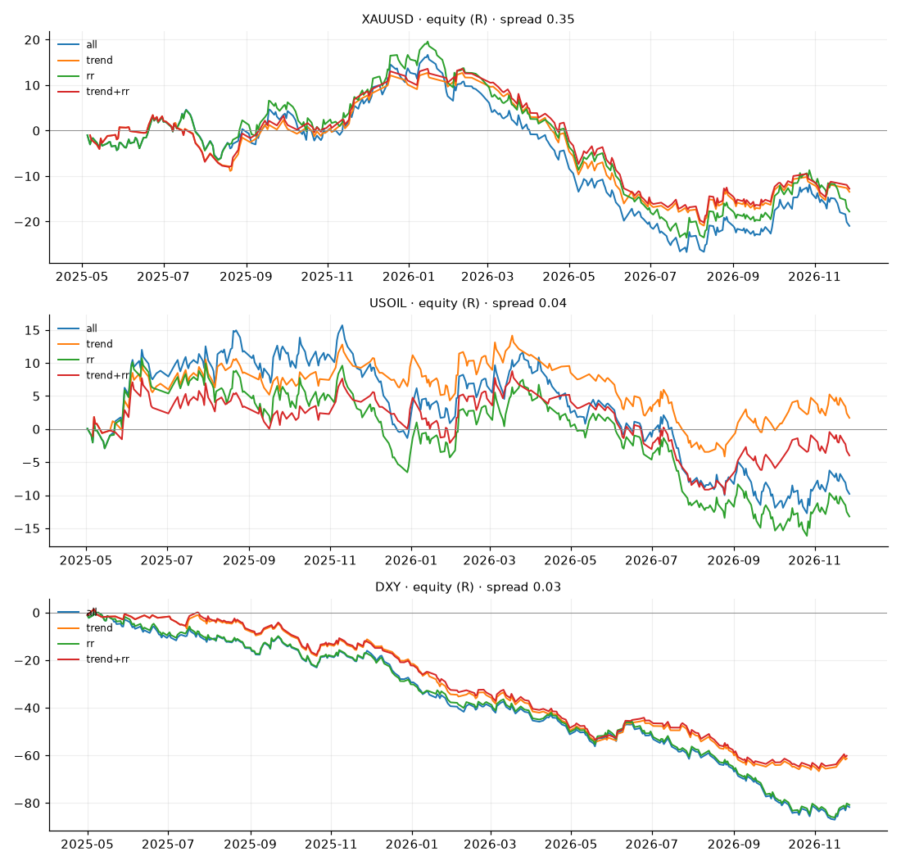

# ผลจำลองบอทเทรดโซน Buy/Sell (Backtest)

ตรรกะเดียวกับการ์ด LINE ตอนเช้า · แท่ง 1 ชม. · ปิดครึ่งที่ TP1 + เลื่อน SL เป็นทุน · ปิดทุกออเดอร์สิ้นวัน · หัก spread แล้ว
R = กำไร/ขาดทุนเทียบกับความเสี่ยงต่อไม้ (เสี่ยง 1% ต่อไม้ → 1R = 1% ของพอร์ต)

## XAUUSD  (Yahoo GC=F H1, spread 0.35)

| filter | period | trades | fill_rate_% | win_rate_% | avg_R | total_R | profit_factor | max_drawdown_R | worst_losing_streak |
|---|---|---|---|---|---|---|---|---|---|
| all | ทั้งหมด | 394 | 48.8 | 41.4 | -0.053 | -21.0 | 0.9 | 43.4 | 10 |
| all | ช่วงแรก 70% | 273 | 48.4 | 40.7 | -0.065 | -17.8 | 0.88 | 34.5 | 10 |
| all | ช่วงท้าย 30% (OOS) | 121 | 49.6 | 43.0 | -0.026 | -3.2 | 0.95 | 9.5 | 8 |
| trend | ทั้งหมด | 247 | 47.5 | 40.9 | -0.055 | -13.5 | 0.89 | 33.6 | 9 |
| trend | ช่วงแรก 70% | 163 | 46.4 | 38.7 | -0.086 | -14.0 | 0.84 | 26.7 | 9 |
| trend | ช่วงท้าย 30% (OOS) | 84 | 49.7 | 45.2 | 0.006 | 0.5 | 1.01 | 7.5 | 5 |
| rr | ทั้งหมด | 384 | 48.6 | 41.7 | -0.046 | -17.8 | 0.91 | 43.2 | 10 |
| rr | ช่วงแรก 70% | 265 | 48.4 | 41.5 | -0.045 | -12.0 | 0.91 | 31.6 | 10 |
| rr | ช่วงท้าย 30% (OOS) | 119 | 49.2 | 42.0 | -0.049 | -5.8 | 0.9 | 12.6 | 8 |
| trend+rr | ทั้งหมด | 240 | 47.5 | 40.8 | -0.053 | -12.8 | 0.9 | 33.8 | 9 |
| trend+rr | ช่วงแรก 70% | 158 | 46.7 | 39.2 | -0.068 | -10.7 | 0.88 | 24.3 | 9 |
| trend+rr | ช่วงท้าย 30% (OOS) | 82 | 49.1 | 43.9 | -0.026 | -2.1 | 0.94 | 9.5 | 5 |

**สรุป:** all: ไม่ผ่าน (ขาดทุนหลังหัก spread) · trend: ไม่ผ่าน (ขาดทุนหลังหัก spread) · rr: ไม่ผ่าน (ขาดทุนหลังหัก spread) · trend+rr: ไม่ผ่าน (ขาดทุนหลังหัก spread)

## USOIL  (Yahoo CL=F H1, spread 0.04)

| filter | period | trades | fill_rate_% | win_rate_% | avg_R | total_R | profit_factor | max_drawdown_R | worst_losing_streak |
|---|---|---|---|---|---|---|---|---|---|
| all | ทั้งหมด | 403 | 49.9 | 45.2 | -0.024 | -9.8 | 0.95 | 28.4 | 8 |
| all | ช่วงแรก 70% | 279 | 49.5 | 46.2 | -0.002 | -0.7 | 1.0 | 17.2 | 8 |
| all | ช่วงท้าย 30% (OOS) | 124 | 50.8 | 42.7 | -0.074 | -9.2 | 0.85 | 15.6 | 5 |
| rr | ทั้งหมด | 384 | 49.1 | 44.5 | -0.034 | -13.2 | 0.93 | 26.9 | 8 |
| rr | ช่วงแรก 70% | 263 | 48.5 | 45.6 | -0.01 | -2.8 | 0.98 | 17.3 | 8 |
| rr | ช่วงท้าย 30% (OOS) | 121 | 50.4 | 42.1 | -0.087 | -10.5 | 0.83 | 15.6 | 6 |
| trend | ทั้งหมด | 277 | 49.7 | 46.2 | 0.006 | 1.7 | 1.01 | 18.3 | 7 |
| trend | ช่วงแรก 70% | 189 | 49.6 | 47.1 | 0.017 | 3.2 | 1.03 | 11.0 | 5 |
| trend | ช่วงท้าย 30% (OOS) | 88 | 50.0 | 44.3 | -0.017 | -1.5 | 0.96 | 10.1 | 5 |
| trend+rr | ทั้งหมด | 264 | 49.0 | 45.1 | -0.015 | -4.0 | 0.97 | 18.6 | 6 |
| trend+rr | ช่วงแรก 70% | 179 | 48.9 | 45.8 | -0.006 | -1.2 | 0.99 | 9.9 | 6 |
| trend+rr | ช่วงท้าย 30% (OOS) | 85 | 49.1 | 43.5 | -0.033 | -2.8 | 0.93 | 10.9 | 6 |

**สรุป:** all: ไม่ผ่าน (ขาดทุนหลังหัก spread) · trend: ไม่ผ่าน (ขาดทุนหลังหัก spread) · rr: ไม่ผ่าน (ขาดทุนหลังหัก spread) · trend+rr: ไม่ผ่าน (ขาดทุนหลังหัก spread)

## DXY  (Yahoo DX-Y.NYB H1, spread 0.03)

| filter | period | trades | fill_rate_% | win_rate_% | avg_R | total_R | profit_factor | max_drawdown_R | worst_losing_streak |
|---|---|---|---|---|---|---|---|---|---|
| all | ทั้งหมด | 402 | 49.0 | 36.8 | -0.203 | -81.8 | 0.67 | 88.0 | 9 |
| all | ช่วงแรก 70% | 278 | 48.4 | 37.4 | -0.179 | -49.6 | 0.7 | 57.2 | 9 |
| all | ช่วงท้าย 30% (OOS) | 124 | 50.4 | 35.5 | -0.259 | -32.1 | 0.6 | 41.1 | 7 |
| rr | ทั้งหมด | 393 | 48.8 | 36.4 | -0.206 | -80.8 | 0.67 | 87.0 | 9 |
| rr | ช่วงแรก 70% | 269 | 48.0 | 36.8 | -0.181 | -48.7 | 0.7 | 56.2 | 9 |
| rr | ช่วงท้าย 30% (OOS) | 124 | 50.4 | 35.5 | -0.259 | -32.1 | 0.6 | 41.1 | 7 |
| trend | ทั้งหมด | 284 | 48.8 | 36.6 | -0.216 | -61.3 | 0.65 | 68.1 | 10 |
| trend | ช่วงแรก 70% | 207 | 48.7 | 35.3 | -0.243 | -50.2 | 0.61 | 56.1 | 10 |
| trend | ช่วงท้าย 30% (OOS) | 77 | 49.0 | 40.3 | -0.144 | -11.1 | 0.76 | 21.3 | 6 |
| trend+rr | ทั้งหมด | 277 | 48.4 | 36.1 | -0.217 | -60.2 | 0.65 | 67.0 | 10 |
| trend+rr | ช่วงแรก 70% | 200 | 48.2 | 34.5 | -0.246 | -49.1 | 0.6 | 55.0 | 10 |
| trend+rr | ช่วงท้าย 30% (OOS) | 77 | 49.0 | 40.3 | -0.144 | -11.1 | 0.76 | 21.3 | 6 |

**สรุป:** all: ไม่ผ่าน (ขาดทุนหลังหัก spread) · trend: ไม่ผ่าน (ขาดทุนหลังหัก spread) · rr: ไม่ผ่าน (ขาดทุนหลังหัก spread) · trend+rr: ไม่ผ่าน (ขาดทุนหลังหัก spread)

### วิธีอ่าน
- **profit_factor** กำไรรวม ÷ ขาดทุนรวม — ต่ำกว่า 1 = ขาดทุน, 1.2+ ถือว่าเริ่มใช้ได้
- **ช่วงท้าย 30% (OOS)** ต้องยังกำไร ถ้ากำไรแค่ช่วงแรก แปลว่าโชคหรือ overfit
- **max_drawdown_R** ติดลบสูงสุดจากยอดสูงสุด ใช้กำหนดความเสี่ยงต่อไม้ (เช่น DD 15R กับเสี่ยง 1% = ลบ 15%)
- DXY เทรดตรงในโบรกเกอร์ส่วนใหญ่ไม่ได้ แสดงไว้เพื่อดูว่าตรรกะใช้ได้กับดัชนีหรือไม่
- ผลในอดีตไม่รับประกันอนาคต ไม่ใช่คำแนะนำการลงทุน
