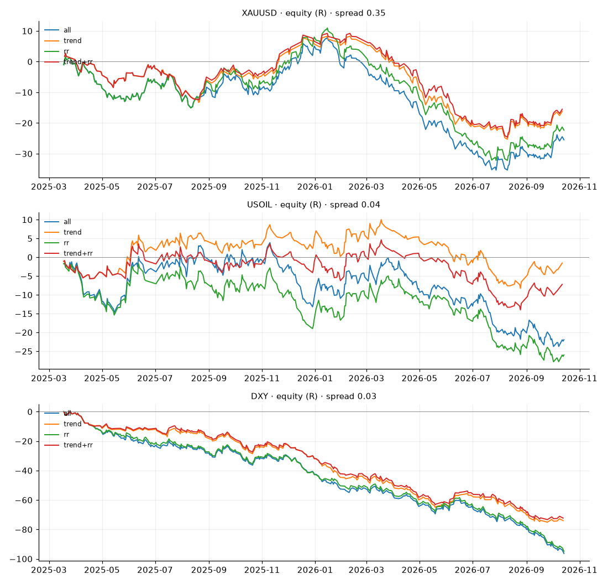

# ผลจำลองบอทเทรดโซน Buy/Sell (Backtest)

ตรรกะเดียวกับการ์ด LINE ตอนเช้า · แท่ง 1 ชม. · ปิดครึ่งที่ TP1 + เลื่อน SL เป็นทุน · ปิดทุกออเดอร์สิ้นวัน · หัก spread แล้ว
R = กำไร/ขาดทุนเทียบกับความเสี่ยงต่อไม้ (เสี่ยง 1% ต่อไม้ → 1R = 1% ของพอร์ต)

## XAUUSD  (Yahoo GC=F H1, spread 0.35)

| filter | period | trades | fill_rate_% | win_rate_% | avg_R | total_R | profit_factor | max_drawdown_R | worst_losing_streak |
|---|---|---|---|---|---|---|---|---|---|
| all | ทั้งหมด | 395 | 48.9 | 40.3 | -0.064 | -25.5 | 0.88 | 43.4 | 10 |
| all | ช่วงแรก 70% | 273 | 48.2 | 40.3 | -0.048 | -13.2 | 0.91 | 23.1 | 10 |
| all | ช่วงท้าย 30% (OOS) | 122 | 50.4 | 40.2 | -0.1 | -12.2 | 0.81 | 22.3 | 9 |
| trend | ทั้งหมด | 252 | 48.5 | 40.1 | -0.064 | -16.2 | 0.88 | 33.6 | 10 |
| trend | ช่วงแรก 70% | 148 | 46.1 | 39.2 | -0.035 | -5.2 | 0.93 | 16.0 | 10 |
| trend | ช่วงท้าย 30% (OOS) | 104 | 52.3 | 41.3 | -0.106 | -11.0 | 0.79 | 20.3 | 9 |
| rr | ทั้งหมด | 385 | 48.7 | 40.5 | -0.058 | -22.3 | 0.89 | 43.2 | 10 |
| rr | ช่วงแรก 70% | 266 | 48.2 | 41.0 | -0.032 | -8.4 | 0.94 | 21.2 | 10 |
| rr | ช่วงท้าย 30% (OOS) | 119 | 50.0 | 39.5 | -0.117 | -13.9 | 0.78 | 24.0 | 9 |
| trend+rr | ทั้งหมด | 245 | 48.5 | 40.0 | -0.063 | -15.5 | 0.88 | 33.8 | 10 |
| trend+rr | ช่วงแรก 70% | 144 | 46.5 | 39.6 | -0.02 | -2.9 | 0.96 | 15.1 | 10 |
| trend+rr | ช่วงท้าย 30% (OOS) | 101 | 51.8 | 40.6 | -0.125 | -12.6 | 0.75 | 22.0 | 9 |

**สรุป:** all: ไม่ผ่าน (ขาดทุนหลังหัก spread) · trend: ไม่ผ่าน (ขาดทุนหลังหัก spread) · rr: ไม่ผ่าน (ขาดทุนหลังหัก spread) · trend+rr: ไม่ผ่าน (ขาดทุนหลังหัก spread)

## USOIL  (Yahoo CL=F H1, spread 0.04)

| filter | period | trades | fill_rate_% | win_rate_% | avg_R | total_R | profit_factor | max_drawdown_R | worst_losing_streak |
|---|---|---|---|---|---|---|---|---|---|
| all | ทั้งหมด | 406 | 50.2 | 44.8 | -0.054 | -21.9 | 0.89 | 27.6 | 9 |
| all | ช่วงแรก 70% | 291 | 51.4 | 45.0 | -0.023 | -6.7 | 0.95 | 17.2 | 9 |
| all | ช่วงท้าย 30% (OOS) | 115 | 47.5 | 44.3 | -0.132 | -15.2 | 0.73 | 17.3 | 7 |
| rr | ทั้งหมด | 386 | 49.5 | 44.0 | -0.067 | -26.0 | 0.87 | 27.8 | 9 |
| rr | ช่วงแรก 70% | 275 | 50.6 | 44.0 | -0.038 | -10.5 | 0.93 | 19.0 | 9 |
| rr | ช่วงท้าย 30% (OOS) | 111 | 47.0 | 44.1 | -0.14 | -15.5 | 0.72 | 17.7 | 7 |
| trend | ทั้งหมด | 272 | 50.1 | 46.3 | -0.006 | -1.5 | 0.99 | 18.3 | 7 |
| trend | ช่วงแรก 70% | 192 | 51.5 | 46.9 | 0.028 | 5.3 | 1.06 | 8.5 | 5 |
| trend | ช่วงท้าย 30% (OOS) | 80 | 47.1 | 45.0 | -0.086 | -6.9 | 0.83 | 13.7 | 7 |
| trend+rr | ทั้งหมด | 259 | 49.4 | 45.2 | -0.028 | -7.2 | 0.94 | 18.6 | 7 |
| trend+rr | ช่วงแรก 70% | 182 | 50.8 | 45.6 | 0.005 | 1.0 | 1.01 | 9.8 | 7 |
| trend+rr | ช่วงท้าย 30% (OOS) | 77 | 46.4 | 44.2 | -0.106 | -8.2 | 0.79 | 15.1 | 6 |

**สรุป:** all: ไม่ผ่าน (ขาดทุนหลังหัก spread) · trend: ไม่ผ่าน (ขาดทุนหลังหัก spread) · rr: ไม่ผ่าน (ขาดทุนหลังหัก spread) · trend+rr: ไม่ผ่าน (ขาดทุนหลังหัก spread)

## DXY  (Yahoo DX-Y.NYB H1, spread 0.03)

| filter | period | trades | fill_rate_% | win_rate_% | avg_R | total_R | profit_factor | max_drawdown_R | worst_losing_streak |
|---|---|---|---|---|---|---|---|---|---|
| all | ทั้งหมด | 398 | 48.5 | 34.7 | -0.242 | -96.3 | 0.61 | 96.6 | 9 |
| all | ช่วงแรก 70% | 277 | 48.3 | 34.7 | -0.218 | -60.3 | 0.64 | 60.6 | 9 |
| all | ช่วงท้าย 30% (OOS) | 121 | 49.2 | 34.7 | -0.298 | -36.0 | 0.56 | 37.1 | 6 |
| trend | ทั้งหมด | 295 | 48.8 | 34.2 | -0.251 | -74.0 | 0.59 | 75.4 | 10 |
| trend | ช่วงแรก 70% | 212 | 49.2 | 33.0 | -0.263 | -55.8 | 0.57 | 56.1 | 10 |
| trend | ช่วงท้าย 30% (OOS) | 83 | 48.0 | 37.3 | -0.219 | -18.2 | 0.65 | 19.8 | 6 |
| rr | ทั้งหมด | 387 | 48.3 | 34.1 | -0.245 | -94.8 | 0.61 | 95.1 | 11 |
| rr | ช่วงแรก 70% | 266 | 47.8 | 33.8 | -0.221 | -58.8 | 0.64 | 59.1 | 11 |
| rr | ช่วงท้าย 30% (OOS) | 121 | 49.2 | 34.7 | -0.298 | -36.0 | 0.56 | 37.1 | 6 |
| trend+rr | ทั้งหมด | 286 | 48.3 | 33.6 | -0.253 | -72.3 | 0.59 | 73.6 | 10 |
| trend+rr | ช่วงแรก 70% | 203 | 48.4 | 32.0 | -0.266 | -54.1 | 0.57 | 54.3 | 10 |
| trend+rr | ช่วงท้าย 30% (OOS) | 83 | 48.0 | 37.3 | -0.219 | -18.2 | 0.65 | 19.8 | 6 |

**สรุป:** all: ไม่ผ่าน (ขาดทุนหลังหัก spread) · trend: ไม่ผ่าน (ขาดทุนหลังหัก spread) · rr: ไม่ผ่าน (ขาดทุนหลังหัก spread) · trend+rr: ไม่ผ่าน (ขาดทุนหลังหัก spread)

### วิธีอ่าน
- **profit_factor** กำไรรวม ÷ ขาดทุนรวม — ต่ำกว่า 1 = ขาดทุน, 1.2+ ถือว่าเริ่มใช้ได้
- **ช่วงท้าย 30% (OOS)** ต้องยังกำไร ถ้ากำไรแค่ช่วงแรก แปลว่าโชคหรือ overfit
- **max_drawdown_R** ติดลบสูงสุดจากยอดสูงสุด ใช้กำหนดความเสี่ยงต่อไม้ (เช่น DD 15R กับเสี่ยง 1% = ลบ 15%)
- DXY เทรดตรงในโบรกเกอร์ส่วนใหญ่ไม่ได้ แสดงไว้เพื่อดูว่าตรรกะใช้ได้กับดัชนีหรือไม่
- ผลในอดีตไม่รับประกันอนาคต ไม่ใช่คำแนะนำการลงทุน
