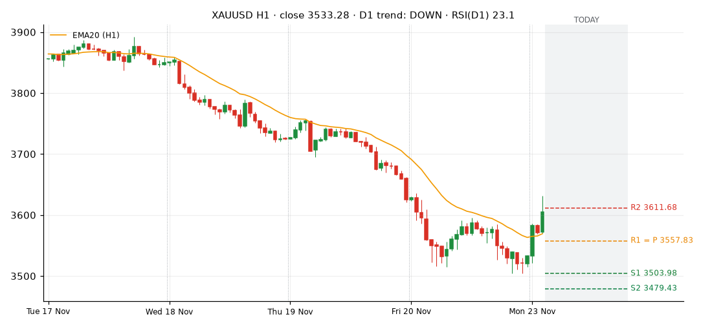
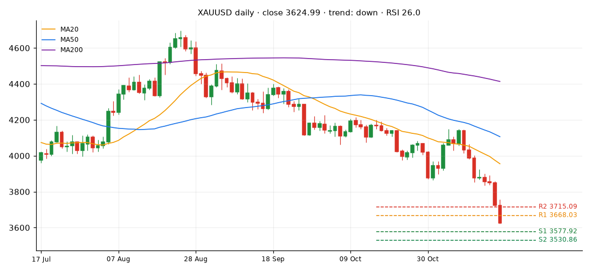

| ตัว | ปิดล่าสุด | แนวต้าน 2 | แนวต้าน 1 | แนวรับ 1 | แนวรับ 2 | กรอบแกว่งวันนี้ (±ATR) |
|---|---|---|---|---|---|---|
| XAUUSD | 3533.28 | 3611.68 | 3557.83 | 3503.98 | 3479.43 | 3430.66 – 3635.91 |
| USOIL | 83.56 | 86.09 | 84.83 | 81.54 | 80.78 | 79.35 – 87.77 |
| DXY | 103.84 | 104.163 | 103.97 | 103.63 | 103.421 | 103.307 – 104.373 |

| ตัว | แนวโน้ม (MA50/200) | ราคาเทียบ MA20 | RSI 14 | MACD | เปลี่ยนแปลง 5 วัน | 20 วัน |
|---|---|---|---|---|---|---|
| XAUUSD | ขาลง | ใต้ | 23.1 (ขายมากเกินไป (<30)) | ลบ แรงขึ้น | -8.9% | -11.57% |
| USOIL | ไซด์เวย์/ไม่ชัด | ใต้ | 36.5 (กลางๆ) | ลบ อ่อนลง | -6.03% | -19.07% |
| DXY | ขาขึ้น | เหนือ | 69.0 (กลางๆ) | บวก อ่อนลง | 0.42% | 1.99% |

### กราฟ H1 (5 วัน) + แนวรับ–แนวต้านวันนี้

### กราฟ D1 (แนวโน้มใหญ่)

แท่งเทียนวันที่ 2026-11-20 · แหล่งข้อมูล: XAUUSD=twelvedata:XAU/USD, USOIL=yahoo_h:CL=F, DXY=yahoo:DX-Y.NYB
