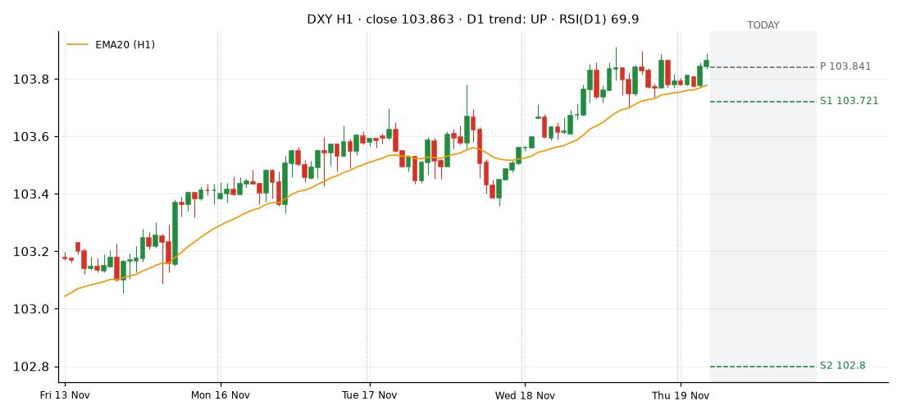

| ตัว | ปิดล่าสุด | แนวต้าน 2 | แนวต้าน 1 | แนวรับ 1 | แนวรับ 2 | กรอบแกว่งวันนี้ (±ATR) |
|---|---|---|---|---|---|---|
| XAUUSD | 3654.41 | 3707.51 | 3689.08 | 3578.68 | 3502.95 | 3539.78 – 3769.05 |
| USOIL | 82.82 | 84.48 | 83.81 | 82.2 | 81.58 | 79.74 – 85.9 |
| DXY | 104.014 | 104.328 | 104.171 | 103.748 | 103.482 | 103.462 – 104.566 |

| ตัว | แนวโน้ม (MA50/200) | ราคาเทียบ MA20 | RSI 14 | MACD | เปลี่ยนแปลง 5 วัน | 20 วัน |
|---|---|---|---|---|---|---|
| XAUUSD | ขาลง | ใต้ | 38.2 (กลางๆ) | ลบ อ่อนลง | 3.43% | -5.7% |
| USOIL | ไซด์เวย์/ไม่ชัด | ใต้ | 39.3 (กลางๆ) | ลบ อ่อนลง | -0.89% | -19.5% |
| DXY | ขาขึ้น | เหนือ | 64.7 (กลางๆ) | บวก อ่อนลง | 0.11% | 1.93% |

### กราฟ H1 (5 วัน) + แนวรับ–แนวต้านวันนี้

### กราฟ D1 (แนวโน้มใหญ่)

แท่งเทียนวันที่ 2026-11-27 · แหล่งข้อมูล: XAUUSD=twelvedata:XAU/USD, USOIL=yahoo_h:CL=F, DXY=yahoo:DX-Y.NYB
