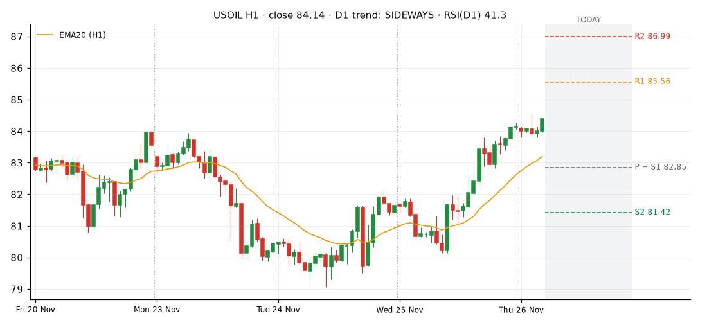
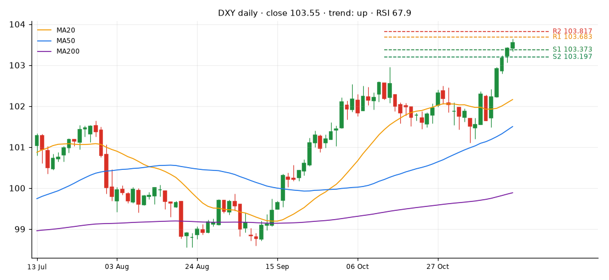

| ตัว | ปิดล่าสุด | แนวต้าน 2 | แนวต้าน 1 | แนวรับ 1 | แนวรับ 2 | กรอบแกว่งวันนี้ (±ATR) |
|---|---|---|---|---|---|---|
| XAUUSD | 3624.99 | 3715.09 | 3668.03 | 3577.92 | 3530.86 | 3524.38 – 3725.6 |
| USOIL | 83.1 | 85.14 | 84.12 | 81.87 | 80.64 | 78.57 – 87.63 |
| DXY | 103.947 | None | None | 103.826 | 103.06 | 103.421 – 104.473 |

| ตัว | แนวโน้ม (MA50/200) | ราคาเทียบ MA20 | RSI 14 | MACD | เปลี่ยนแปลง 5 วัน | 20 วัน |
|---|---|---|---|---|---|---|
| XAUUSD | ขาลง | ใต้ | 26.0 (ขายมากเกินไป (<30)) | ลบ แรงขึ้น | -6.51% | -9.93% |
| USOIL | ไซด์เวย์/ไม่ชัด | ใต้ | 35.4 (กลางๆ) | ลบ อ่อนลง | -6.36% | -16.2% |
| DXY | ขาขึ้น | เหนือ | 70.5 (ซื้อมากเกินไป (>70)) | บวก แรงขึ้น | 0.75% | 2.3% |

### กราฟ H1 (5 วัน) + แนวรับ–แนวต้านวันนี้

### กราฟ D1 (แนวโน้มใหญ่)

แท่งเทียนวันที่ 2026-11-19 · แหล่งข้อมูล: XAUUSD=twelvedata:XAU/USD, USOIL=yahoo_h:CL=F, DXY=yahoo:DX-Y.NYB
