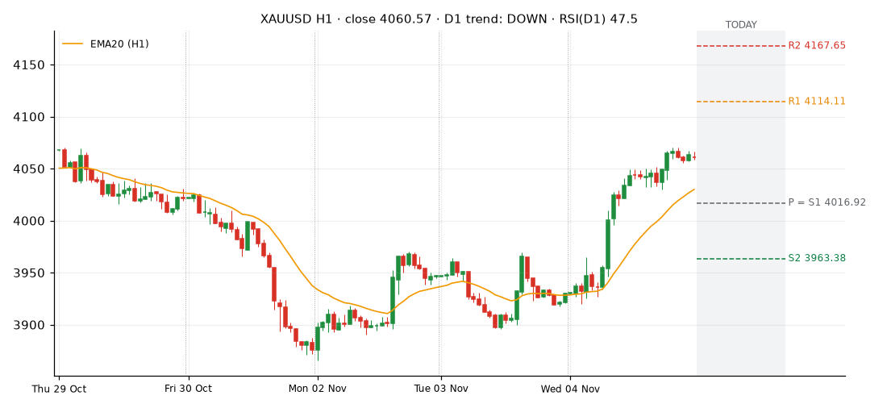
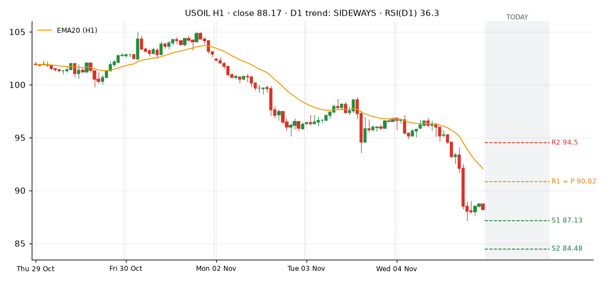
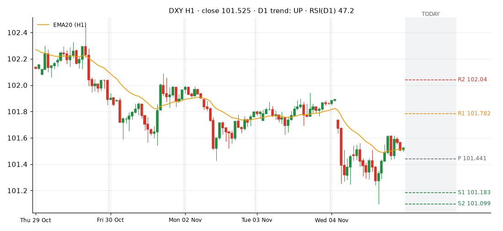
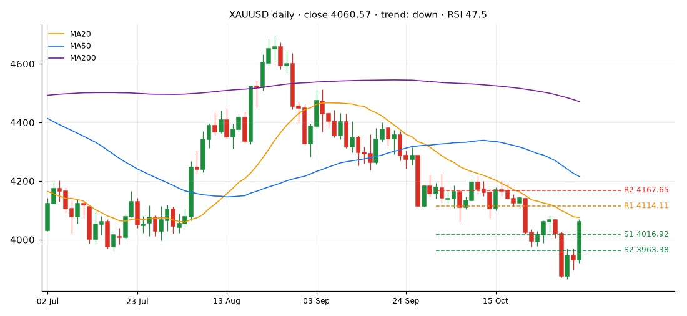
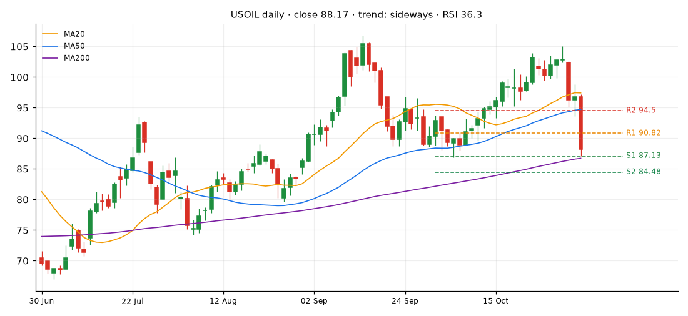
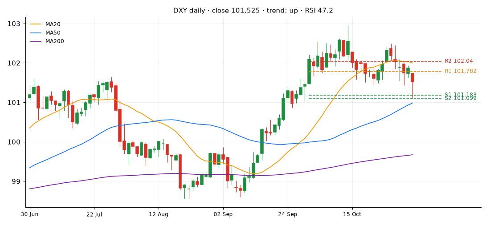

| ตัว | ปิดล่าสุด | แนวต้าน 2 | แนวต้าน 1 | แนวรับ 1 | แนวรับ 2 | กรอบแกว่งวันนี้ (±ATR) |
|---|---|---|---|---|---|---|
| XAUUSD | 4060.57 | 4167.65 | 4114.11 | 4016.92 | 3963.38 | 3982.4 – 4138.74 |
| USOIL | 88.17 | 94.5 | 90.82 | 87.13 | 84.48 | 83.62 – 92.72 |
| DXY | 101.525 | 102.04 | 101.782 | 101.183 | 101.099 | 101.065 – 101.985 |

| ตัว | แนวโน้ม (MA50/200) | ราคาเทียบ MA20 | RSI 14 | MACD | เปลี่ยนแปลง 5 วัน | 20 วัน |
|---|---|---|---|---|---|---|
| XAUUSD | ขาลง | ใต้ | 47.5 (กลางๆ) | ลบ อ่อนลง | -0.17% | -1.22% |
| USOIL | ไซด์เวย์/ไม่ชัด | ใต้ | 36.3 (กลางๆ) | ลบ แรงขึ้น | -13.57% | -0.82% |
| DXY | ขาขึ้น | ใต้ | 47.2 (กลางๆ) | ลบ แรงขึ้น | -0.65% | -0.7% |

### กราฟ H1 (5 วัน) + แนวรับ–แนวต้านวันนี้

### กราฟ D1 (แนวโน้มใหญ่)

แท่งเทียนวันที่ 2026-11-04 · แหล่งข้อมูล: XAUUSD=twelvedata:XAU/USD, USOIL=yahoo_h:CL=F, DXY=yahoo:DX-Y.NYB
