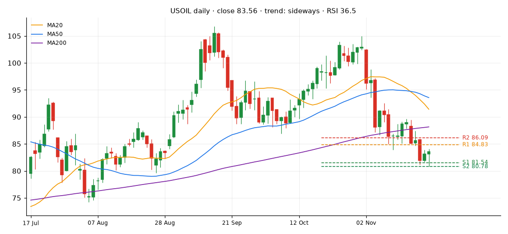

| ตัว | ปิดล่าสุด | แนวต้าน 2 | แนวต้าน 1 | แนวรับ 1 | แนวรับ 2 | กรอบแกว่งวันนี้ (±ATR) |
|---|---|---|---|---|---|---|
| XAUUSD | 3725.23 | 3816.02 | 3767.61 | 3676.81 | 3628.4 | 3623.34 – 3827.11 |
| USOIL | 81.97 | 84.88 | 83.04 | 80.13 | 78.29 | 77.42 – 86.52 |
| DXY | 103.882 | None | None | 103.727 | 102.8 | 103.325 – 104.439 |

| ตัว | แนวโน้ม (MA50/200) | ราคาเทียบ MA20 | RSI 14 | MACD | เปลี่ยนแปลง 5 วัน | 20 วัน |
|---|---|---|---|---|---|---|
| XAUUSD | ขาลง | ใต้ | 29.8 (ขายมากเกินไป (<30)) | ลบ แรงขึ้น | -6.59% | -10.04% |
| USOIL | ไซด์เวย์/ไม่ชัด | ใต้ | 32.8 (กลางๆ) | ลบ แรงขึ้น | -5.17% | -16.09% |
| DXY | ขาขึ้น | เหนือ | 70.0 (ซื้อมากเกินไป (>70)) | บวก แรงขึ้น | 0.94% | 2.07% |

### กราฟ H1 (5 วัน) + แนวรับ–แนวต้านวันนี้

### กราฟ D1 (แนวโน้มใหญ่)

แท่งเทียนวันที่ 2026-11-18 · แหล่งข้อมูล: XAUUSD=twelvedata:XAU/USD, USOIL=yahoo_h:CL=F, DXY=yahoo:DX-Y.NYB
